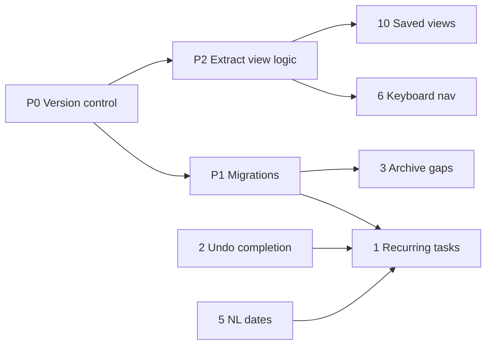

# Stage 5: Feature Roadmap

Actionable plan for the ten follow-up features identified in the post-Stage-4 review. Each feature lists its current state, scope, design, the files it touches, tests, and acceptance criteria. Features that are already partly or fully built (2, 3, 4) are included with a verification checklist and the remaining gaps, so they are finished properly rather than assumed done.

## Status Summary

| # | Feature | Status | Effort | Phase |
| :- | :--- | :--- | :- | :- |
| P0–P2 | Prerequisites (version control, migrations, view-logic extraction) | Not started | M | 0 |
| 1 | Recurring tasks | Not started | L | B |
| 2 | Undo for delete, complete and clear | Partial (delete, archive) | S | A |
| 3 | Archive instead of delete | Implemented, gaps remain | S | A |
| 4 | Drag-to-reorder (manual sort) | Implemented, gaps remain | S | A |
| 5 | Natural-language dates in quick-add | Not started | S | A |
| 6 | Keyboard navigation of the task list | Not started | M | A |
| 7 | Automatic local backups | Not started | S | B |
| 8 | Real markdown in notes | Not started | M | C |
| 9 | Completion trends and per-project progress | Not started | M | C |
| 10 | Saved filters (named views) | Not started | M | C |

Effort: **S** ≈ half a day, **M** ≈ one day, **L** ≈ two to three days.

## Delivery Order

- **Phase 0:** P0, P1, P2. Everything else builds on them.
- **Phase A (quick wins):** 2, 3, 4, 5, 6.
- **Phase B (data features):** 1, 7. Build 7 before 1, because recurring tasks are the first feature to change the schema of real user data.
- **Phase C (presentation):** 8, 9, 10.

## Definition of Done (every feature)

- [ ] `npx tsc --noEmit -p .` is clean, `npm test` passes, `npm run build` succeeds.
- [ ] New logic lives in pure functions with tests in `src/server/__tests__/` (server routes through `app.inject`, client helpers imported directly, as the existing tests do).
- [ ] Browser check against a throwaway database (`DB_PATH=<temp>/test.db PORT=3011 npm start`) in light and dark mode, using mouse and keyboard.
- [ ] Any new persisted data goes through JSON export → import without loss, and old (v1) backups still import.
- [ ] Any destructive action has a confirmation that names its scope, plus undo where feasible (the pattern from Stage 4 fixes).
- [ ] Status table above and `PLAN.md` updated.

---

## Phase 0: Prerequisites

### P0. Version control
The repository is not under git, so none of this work can be reviewed as a diff or rolled back.
- [ ] `git init`, check `.gitignore` covers `data/`, `dist/`, `node_modules/` and `tsconfig.tsbuildinfo` (add the last one).
- [ ] Baseline commit of the current state before any Stage 5 work (needs the owner's go-ahead per commit rules).
- [ ] One branch (or at least one commit) per feature below.

### P1. Schema migrations
Today the schema is created by `CREATE TABLE IF NOT EXISTS` in `src/server/db/index.ts`, which never alters an existing table. Feature 1 (and the archive gap in feature 3) need new columns, so this is a hard prerequisite.

Design: a numbered migration list keyed on `PRAGMA user_version`. No new dependency (`drizzle-kit` stays unused).
- [ ] `src/server/db/migrations.ts`: `export const MIGRATIONS: string[]`, where index 0 is the existing `CREATE TABLE`/`CREATE INDEX` SQL moved out of `db/index.ts`.
- [ ] In `createDatabase`: read `user_version`; run each pending migration and bump `user_version` inside one transaction. Existing databases (version 0 with tables present) must not fail: migration 0 keeps `IF NOT EXISTS`.
- [ ] Keep `src/server/db/schema.ts` (Drizzle) in sync with every migration.
- [ ] Test: create a DB file with only the old v0 schema, open it with `createDatabase`, assert new columns exist and existing rows survive.

### P2. Extract view logic from `App.tsx`
Filtering, sorting and grouping live inline in `App.tsx` (about 150 lines). Keyboard navigation (6) needs the flattened visible order, and saved views (10) need to serialise and reapply the same filter state.
- [ ] New `src/client/utils/taskView.ts` with pure functions:
  - `filterTasks(tasks, { nav, search, priority, projects, today })`
  - `sortTasks(tasks, sortBy)`
  - `groupTasks(tasks, groupBy, projects)` returning `{ key, label, tasks }[]`
  - `visibleTaskOrder(sections, completedSection, showCompleted)` returning the flat list of task ids exactly as rendered.
- [ ] Define `ViewState = { nav, search, priority, groupBy, sortBy }` here; `App.tsx` holds one `ViewState` instead of five separate `useState` calls.
- [ ] `App.tsx` calls these functions; behaviour must not change.
- [ ] Tests: Today/Upcoming/Completed/Archive filters, search across title/description/tag/project, each sort (including manual ties), each grouping, and that archived tasks appear only in the Archive view.

---

## Phase A: Quick Wins

### 2. Undo for delete, complete and clear
**State:** Delete (tasks, subtasks, projects, quick links, bulk archived delete) uses deferred commit with Undo (`utils/useDeferredDelete.ts`, `components/Feedback.tsx`). "Clear completed" now archives with Undo. **Completing a task has no undo.**

Remaining work:
- [ ] Completion undo: when `handleToggleTask` marks a task done from a row, show `Completed "<title>"` with Undo. Undo PATCHes the task back to its **previous** status (`todo` or `in_progress`, captured before the toggle), and the server clears `completedAt`. With feature 1, Undo must also remove the spawned next occurrence (see feature 1).
- [ ] `Ctrl+Z` / `Cmd+Z` runs the current toast's Undo when focus is not in a text field (add to the global key handler in `App.tsx`; it must not hijack undo inside inputs).
- [ ] Accessibility (WCAG 2.2.1, timing adjustable): pause the toast's dismiss timer while it is hovered or focused. The deferred-delete timer must pause and resume with it, so Undo never appears available after the delete has been sent. Extend `useDeferredDelete` with `pause(key)` / `resume(key)`.
- [ ] Decide and document what happens when a second toast replaces the first. Current behaviour: the first action's Undo is no longer reachable, but its delete still commits on time. That is acceptable; note it in `Feedback.tsx`.

Acceptance:
- [ ] Complete → Undo restores the exact prior status and leaves `completedAt` null.
- [ ] Hovering the toast for 10 seconds, then clicking Undo, still restores the item; the server never received the DELETE.
- [ ] `Ctrl+Z` in the quick-add input undoes typing, not the last action.

### 3. Archive instead of delete
**State:** Implemented. Archive view in the sidebar and command palette; row Archive/Restore; drawer status "Archived"; bulk archive/restore/delete routes (`/api/tasks/bulk-*`); archiving keeps `completedAt`; archived completions count towards "done today" and the streak.

Verification checklist (run before closing):
- [ ] Archived tasks are hidden from Inbox, Today, Upcoming, Completed, project and tag views, from sidebar counts, and from the tag list.
- [ ] Search inside the Archive view filters archived tasks only.
- [ ] Bulk archive from Completed archives only the tasks shown (search and priority filter respected); the confirmation names the scope correctly in Inbox, project, tag and Completed views.
- [ ] "Archive all completed" from the command palette covers every project.
- [ ] Restore returns completed tasks to Completed with the original `completedAt`.
- [ ] JSON export includes archived tasks; import restores them as archived; CSV shows status `archived`.

Gaps to fix:
- [ ] **In-progress tasks restore as To Do.** Restore infers status from `completedAt`, so an archived `in_progress` task comes back as `todo`. Fix: migration (P1) adding `status_before_archive TEXT NULL`. Set it in `bulk-archive` and in the PATCH route when moving to `archived`; use it in `bulk-restore`, falling back to the current `completedAt` rule when null. Clear it on restore.
- [ ] **Overall progress drops when tasks are archived.** `computeDashboardStats.completionRate` counts only `done`, so archiving completed work lowers the percentage (seen: 50% → 0%). Decide: (a) keep "progress of non-archived work" and relabel the card "Current progress"; or (b) count archived-with-`completedAt` as completed. Recommendation: (a). Archive means "out of sight", and the trend chart in feature 9 covers history.
- [ ] Add an Archive action to the command palette for the task open in the drawer, and an `a` shortcut (feature 6).
- [ ] Tests (in P2's `taskView` tests and the server tests): archive/restore of an `in_progress` task round-trips its status.

### 4. Drag-to-reorder (manual sort)
**State:** Implemented. `components/ReorderableTaskList.tsx` (native drag and drop, drop indicator, `Alt+↑/↓`, plain arrows on the handle), `sortOrderForMove` in `taskUtils.ts` (midpoint between neighbours) with a renumber fallback when there is no gap. Enabled only when Sort is Manual and Group is None.

Verification checklist:
- [ ] Drag to top, middle and bottom; drop on the top or bottom half of a row lands before or after it.
- [ ] Order survives reload and is the same on another browser tab.
- [ ] `Alt+↑/↓` does nothing when focus is in a `<select>` or input (no native dropdown hijack).
- [ ] Tasks imported with identical `sortOrder` can still be reordered (renumber path).
- [ ] New tasks appear at the top in Manual sort.

Gaps to fix:
- [ ] **Touch devices.** HTML5 drag and drop is unreliable on touch screens. Verify on a phone or tablet. If it fails, add Move up/Move down items to a row overflow menu (the keyboard path already contains the logic: `onMove(id, index ± 1)`). Do not add a drag library unless this proves insufficient.
- [ ] **Renumbering is client-side and partial.** The fallback sends one PATCH per task, and only for visible tasks (marked `ponytail:` in `App.tsx`). Replace it with `POST /api/tasks/reorder { ids: string[] }` that rewrites `sort_order` for those ids in one transaction, spacing them across the range they already occupy, so hidden tasks keep their relative position.
- [ ] Out of scope (document only): reordering inside grouped views, and dragging between groups to change priority or project.

### 5. Natural-language dates in quick-add
**State:** `parseQuickAddSyntax` (`utils/taskUtils.ts`) supports `@today`, `@tomorrow`/`@tmrw` and `@YYYY-MM-DD`.

Scope:
- [ ] Weekdays: `@mon` … `@sun` (also full names). Resolve to the **next** occurrence strictly after today, so `@mon` typed on a Monday means next Monday. Document this in the placeholder or help.
- [ ] Relative: `@+3d`, `@+2w`, `@+1m` (month adds clamp to the month end: 31 Jan + 1m = 28/29 Feb).
- [ ] `@next-week` means next Monday; `@eom` means the last day of this month.
- [ ] All arithmetic on local calendar dates via `Date#setDate`/`setMonth` with clamping; output through `formatIsoDateFromTimestamp`. No date library.
- [ ] Inject `today` for testability: `parseQuickAddSyntax(input, projects, defaults, today = new Date())`.
- [ ] **Live preview chips** under the quick-add input showing what will be applied (for example `Due Mon 27 Oct · High · Work · #auth`). This makes the syntax discoverable. Compute with the same parser on each keystroke (cheap).
- [ ] The scratchpad "Convert top line to Task" uses the same parser, so it gains this for free; verify.

Tests: each token on a fixed `today` (including a Monday, the 31st of a month, and the 29th of February), unknown tokens left in the title, and a title that is only tokens (falls back to the raw text, as today).

### 6. Keyboard navigation of the task list
Depends on P2 (`visibleTaskOrder`).

Design:
- State `focusedTaskId` in `App.tsx`. The focused row gets `tabIndex=0` and real DOM focus (roving tabindex); other rows get `tabIndex=-1`. A visible focus ring uses the existing `isSelected` styling, but distinct.
- Shortcuts are active only when focus is not in an input, select, textarea or the drawer, and no dialog or palette is open (same guard as the existing global handler).

| Key | Action |
| :- | :- |
| `j` / `↓` | Next task in visible order (skips collapsed Completed) |
| `k` / `↑` | Previous task |
| `x` / `Space` | Toggle complete (with the undo toast from feature 2) |
| `Enter` | Open the drawer |
| `e` | Rename inline |
| `a` | Archive / restore |
| `Delete` / `Backspace` | Delete (confirmation and undo, as now) |
| `1`–`4`, `0` | Set priority Low…Urgent, None |
| `Alt+↑/↓` | Move (manual sort, already built) |
| `?` | Shortcut help dialog |
| `Esc` | Clear row focus |

Tasks:
- [ ] Inline rename is internal state in `TaskRow`. Lift it to a prop: `editing` plus `onEditingChange`, so `e` can start it.
- [ ] After toggle, archive or delete removes the row from the view, move focus to the next row (or the previous one if it was last).
- [ ] `scrollIntoView({ block: 'nearest' })` when focus moves.
- [ ] `?` opens a native `<dialog>` (reuse the `ConfirmDialog` styling) listing all shortcuts; update the command palette footer text.
- [ ] Ensure `↑/↓` don't conflict with the reorder handle (handle arrows only act when the handle itself has focus).

Acceptance: complete a full triage of 10 tasks (navigate, prioritise, complete, archive, delete, rename) without touching the mouse; screen reader announces the focused task title.

---

## Phase B: Data Features

### 7. Automatic local backups
Build this before feature 1 so users have a restore point before the first schema migration touches their data.

Design: `better-sqlite3` has `db.backup(destination)` (an online, consistent copy that works with WAL).
- [ ] `src/server/backup.ts`: `backupDatabase(sqlite, dir, keep)` writes `dashboard-YYYY-MM-DDTHH-mm-ss.db` into `dir`, then deletes the oldest files beyond `keep`. Skip when the DB path is `:memory:`.
- [ ] Triggers:
  - on server start (after migrations, so a broken migration is caught by the backup taken just before it: run one backup **before** migrations too when `user_version` is behind);
  - every 24 hours (`setInterval(...).unref()`, cleared in `onClose`);
  - before every `POST /api/import`.
- [ ] Config via env: `BACKUP_DIR` (default `data/backups`), `BACKUP_KEEP` (default 14).
- [ ] `GET /api/backups` lists files with timestamp and size; `POST /api/backups` makes one now.
- [ ] Overview page: "Last backup: <relative time> · Back up now" under the export buttons.
- [ ] Restore stays manual and documented (stop the server, copy the backup over `data/dashboard.db`, start). In-app restore is out of scope; if added later it needs a confirmation and a pre-restore backup.
- [ ] Errors (disk full, permissions) are logged and surfaced in the API response, never crash the server.

Tests: with a temp file DB, call `backupDatabase` `keep + 2` times and assert exactly `keep` files remain and the newest opens with the expected rows; `POST /api/import` creates a backup first.

### 1. Recurring tasks
Depends on P1 (columns), 2 (completion undo), 5 (shared date arithmetic), 7 (backup before migrating).

Data model (migration 1):
- `recurrence TEXT NULL`: JSON `{ "every": number, "unit": "day" | "week" | "month", "from": "due" | "completion" }`.
- `recurrence_parent_id TEXT NULL`: the task this occurrence was spawned from (for undo).
- Shared Zod `RecurrenceSchema` in `src/shared/types.ts`; add `recurrence` to Task, Create, Update and Backup schemas (v1 backups import with `recurrence: null`).

Behaviour (server, `PATCH /api/tasks/:id` in one transaction):
- [ ] When a task with `recurrence` moves to `done` from a non-done status, insert the next occurrence. It copies title, description, priority, project, tags and recurrence; copies subtasks with `isCompleted = false`; sets `status = 'todo'`, `recurrence_parent_id = <completed id>`, and gives it a new id and timestamps.
- [ ] Next due date: `from: "due"` adds the interval to the old due date (or to today if there was none), repeating until the date is after today, so a task that is 3 weeks overdue doesn't spawn something already overdue. `from: "completion"` adds the interval to today. Month arithmetic clamps like feature 5; share the helper in `src/shared/` so server and client agree.
- [ ] The completed task keeps its recurrence for history, but must never spawn again (a guard: spawn only if no task with this `recurrence_parent_id` exists).
- [ ] Un-completing (moving back to `todo`/`in_progress`) deletes the spawned occurrence **only if it is untouched** (`updatedAt === createdAt` and no subtasks completed); otherwise leave it and say so in the response.
- [ ] Response includes `spawnedTaskId` so the client toast can say `Completed "Pay rent" · next due 1 Dec`.
- [ ] Archiving or bulk-archiving never spawns.
- [ ] Deleting a recurring task deletes only that occurrence.

UI:
- [ ] Drawer: "Repeat" control: None, Daily, Weekdays\*, Weekly, Monthly, Custom (every N days/weeks/months, from due date or completion date).
- [ ] Row and drawer show a repeat icon with a tooltip such as "Every 2 weeks from due date".
- [ ] Quick-add tokens: `*daily`, `*weekly`, `*monthly`, `*3d`, `*2w`, `*1m`; append `!` for from-completion, e.g. `*2w!` (decide final syntax and show it in the preview chips from feature 5).

\*"Weekdays" (Monday–Friday) needs a different rule shape (`weekdays: number[]`). Defer unless asked; keep the JSON open to extension.

Tests: next-date maths (month end, leap year, overdue catch-up, from-completion); completing spawns exactly one; double completion spawns once; un-complete removes an untouched spawn and keeps an edited one; export/import round trip keeps recurrence.

---

## Phase C: Presentation

### 8. Real markdown in notes
**State:** `renderMarkdownPreview` in `TaskDetailDrawer.tsx` handles headings and bullets only. Links render as plain text.

Decision: use `react-markdown` + `remark-gfm` rather than extending the hand-written renderer. Markdown parsing has many edge cases (nesting, code spans, emphasis inside links), and `react-markdown` renders to React elements with no `dangerouslySetInnerHTML`. Its default URL transform already drops `javascript:` links. This is the only new runtime dependency in this plan; justify it in the PR.

Scope:
- [ ] Support links and autolinks, bold, italic, inline code, code blocks, ordered and unordered lists, headings, blockquotes, and GFM task lists.
- [ ] Custom `a` renderer: allow only `http:`, `https:` and `mailto:`; open in a new tab with `rel="noreferrer noopener"`.
- [ ] **Clickable checklists:** `- [ ]` items in the preview toggle in place. Use the list item's `node.position.start.line` to flip `[ ]` ↔ `[x]` on that source line, then call `onUpdateTask(id, { description })`. Put the line edit in a pure `toggleMarkdownCheckbox(text, line)` function.
- [ ] Open the drawer in Preview mode when the description is non-empty, so links and checkboxes are usable immediately; Edit stays one click away.
- [ ] Style with Tailwind classes on the custom renderers (no typography plugin needed); check dark mode.
- [ ] Optional: the row's notes indicator shows checklist progress (`2/5`) when the description contains task-list items.

Tests: `toggleMarkdownCheckbox` (first/last line, indented items, `[X]` uppercase, a line that isn't a checkbox is unchanged); a `javascript:` link does not render as a clickable href.

### 9. Completion trends and per-project progress
Read the `dataviz` skill before building the charts.

Data (pure functions in `taskUtils.ts`, with tests):
- [ ] `completionsByDay(tasks, days = 14, today)` returns a `{ date, count }[]` covering every day in the range, including zeros. It counts tasks with `completedAt` whose status is `done` or `archived` (same rule as the streak).
- [ ] `projectProgress(tasks, projects)` returns `{ projectId | null, name, color, done, total }[]` over non-archived tasks, including a "No project" row, sorted by most open tasks first.

UI (Overview page, `DashboardWidgets.tsx`):
- [ ] "Last 14 days" card: inline SVG bar chart (no chart library), one bar per day with the weekday initial under it, today highlighted, plus a total and a comparison with the previous 14 days. Include a visually hidden table of the same numbers, and `<title>` on bars for hover.
- [ ] "Projects" card: one row per project with its colour dot, name, `done/total` and a progress bar; clicking a row opens that project view.
- [ ] New widget toggle `showTrends` in `WidgetConfigSchema` (default true) and in the Widgets settings bar.
- [ ] Empty states (no completions yet, no projects).
- [ ] Light and dark colours checked for contrast.

Tests: zero-filled days, completions at local midnight boundaries, archived completions counted, project rows include "No project" and exclude archived tasks.

### 10. Saved filters (named views)
Depends on P2 (`ViewState`).

Data: stored in `key_value_store` under `saved_views` (no migration):
`SavedView = { id, name, view: ViewState, createdAt }`, validated by a Zod `SavedViewSchema` in `src/shared/types.ts`.

API:
- [ ] `GET /api/dashboard` includes `savedViews`.
- [ ] `PUT /api/dashboard/saved-views` replaces the full list (validated; maximum 50).
- [ ] Include `savedViews` in export; import merges by id. Bump export `version` to 2; v1 imports still work.

UI:
- [ ] Toolbar: "Save view" opens an inline name input and stores the current `ViewState`.
- [ ] Sidebar "Saved Views" section (under Projects) with a live count of matching active tasks; click applies the whole `ViewState`.
- [ ] When the current state differs from the applied saved view, show a "modified" dot plus "Update view" and "Save as new".
- [ ] Rename inline; delete with confirmation and undo (reuse `useDeferredDelete`).
- [ ] If a saved view points at a deleted project or tag, apply its filters on top of "All Active" and show a one-line notice instead of failing.
- [ ] Command palette: "Go to view: <name>".

Tests: schema validation, export/import round trip, applying a view whose project no longer exists.

---

## Out of Scope (for now)
- Multi-user, accounts, sync, or remote access. The server stays loopback-only (see the Origin/Host guard in `src/server/index.ts`).
- Notifications or reminders (would need a service worker or OS integration).
- A component test harness (jsdom + Testing Library). Keep UI logic in pure functions and verify the UI in the browser; revisit if UI regressions start slipping through.
