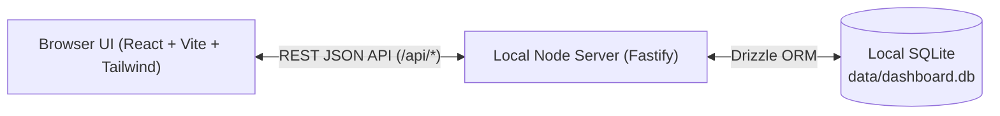

# Dashboard — Architecture & Iterative Implementation Plan

## Status Summary

| Stage | Name | Status |
| :--- | :--- | :--- |
| **Stage 1** | Foundation & Core Checklist MVP | **Completed** |
| **Stage 2** | Organization, Grouping, Filtering & Search | **Completed** |
| **Stage 3** | Task Detail Drawer, Subtasks & Keyboard-First UX | **Completed** |
| **Stage 4** | Dashboard Overview, Widgets & Data Portability | **Completed** |
| **Stage 5** | Feature Roadmap (see [PLAN-STAGE5.md](PLAN-STAGE5.md)) | **Planned** |

---

## 1. Overview & Vision
**Dashboard** is a fast, local-first web application and server for managing personal tasks from a browser session, designed with a modular architecture so additional dashboard widgets and tools can be plugged in over time.

The core experience centers on a **Checklist / List View** with fast keyboard entry, rich filtering, and flexible grouping, plus a **Dashboard Home Overview** and collapsible summary widgets, backed by a lightweight local SQLite database that requires zero external cloud setup.

---

## 2. Recommended Tech Stack

| Layer | Technology | Rationale |
| :--- | :--- | :--- |
| **Runtime / Package Manager** | **Node.js (TypeScript)** + **npm** | Universal, fast, full type safety across client and server. |
| **Frontend Framework** | **React 19 + Vite** | Instant HMR, fast builds, rich ecosystem for keyboard-driven UIs. |
| **Styling & UI** | **Tailwind CSS v4 + Lucide Icons** | Clean, modern dark/light mode aesthetic (Linear/Todoist-inspired) with minimal overhead. |
| **Backend Server** | **Fastify** | Lightweight local HTTP server serving both the REST API (`/api/*`) and the built frontend in production. |
| **Database & ORM** | **SQLite (`better-sqlite3`) + Drizzle ORM** | Single local file (`data/dashboard.db`) on disk—fast, zero-config, ACID-compliant, easy to back up or inspect. |
| **Validation & State** | **Zod + TanStack Query** | Shared schema validation between API & UI, with optimistic UI updates for instant task toggling. |

---

## 3. Data Model (Core Schema)

Stored locally in `data/dashboard.db`:

### `projects` (or Categories)
- `id` (TEXT / UUID, Primary Key)
- `name` (TEXT, e.g., "Work", "Personal", "Inbox")
- `color` (TEXT, hex or token name)
- `sort_order` (INTEGER)
- `created_at` (INTEGER / Timestamp)

### `tasks`
- `id` (TEXT / UUID, Primary Key)
- `title` (TEXT, required)
- `description` (TEXT, optional markdown notes)
- `status` (TEXT: `'todo'` | `'in_progress'` | `'done'` | `'archived'`)
- `priority` (INTEGER: `0` None, `1` Low, `2` Medium, `3` High, `4` Urgent)
- `project_id` (TEXT, Foreign Key -> `projects.id`, nullable)
- `tags` (TEXT / JSON array of strings)
- `due_date` (TEXT, ISO date `YYYY-MM-DD`, nullable)
- `sort_order` (REAL, for manual reordering)
- `completed_at` (INTEGER / Timestamp, nullable)
- `created_at` (INTEGER / Timestamp)
- `updated_at` (INTEGER / Timestamp)

### `subtasks`
- `id` (TEXT / UUID, Primary Key)
- `task_id` (TEXT, Foreign Key -> `tasks.id` ON DELETE CASCADE)
- `title` (TEXT)
- `is_completed` (INTEGER / Boolean)
- `sort_order` (INTEGER)

### `quick_links` & `key_value_store`
- `quick_links`: Stores customizable URL bookmarks (`id`, `title`, `url`, `category`, `sort_order`, `created_at`).
- `key_value_store`: Stores persistent scratchpad markdown and modular widget visibility preferences (`key`, `value`, `updated_at`).

---

## 4. Iterative Delivery Stages

### Stage 1: Foundation & Core Checklist MVP — ✅ COMPLETED
**Goal:** A working local server and database with a clean, responsive checklist UI where you can add, complete, edit, and delete tasks immediately.

- **Deliverables:**
  1. [x] Project scaffolding (`package.json`, TypeScript config, Vite + Backend server setup, single `npm run dev` script).
  2. [x] SQLite database initialization (`data/dashboard.db`) and Drizzle schema for `tasks` and `projects`.
  3. [x] REST API endpoints for Tasks (`GET /api/tasks`, `POST /api/tasks`, `PATCH /api/tasks/:id`, `DELETE /api/tasks/:id`).
  4. [x] Core Checklist UI:
     - Quick-add input bar at the top (press `Enter` to create immediately).
     - Interactive task rows with animated completion checkbox, inline title editing, and delete action.
     - Active vs. Completed task sections with counts.
     - Dark/Light theme support.

---

### Stage 2: Organization, Grouping, Filtering & Search — ✅ COMPLETED
**Goal:** Turn the flat checklist into a structured task manager with priorities, due dates, projects/tags, and smart views.

- **Deliverables:**
  1. [x] Sidebar navigation with smart views:
     - **Inbox / All Active**
     - **Today & Overdue**
     - **Upcoming**
     - **Completed**
     - **Custom Projects / Categories** (create/edit/delete projects with color badges).
  2. [x] Task metadata controls:
     - Priority selector (`None`, `Low`, `Medium`, `High`, `Urgent`) with visual indicators.
     - Due date picker with relative labels ("Today", "Tomorrow", "Overdue").
     - Tag pills.
  3. [x] List View toolbar:
     - **Group by:** Status, Priority, Project, or Due Date.
     - **Sort by:** Priority, Due Date, Created Date, or Manual order.
     - **Instant filter / search bar** to filter tasks as you type.

---

### Stage 3: Task Detail Drawer, Subtasks & Keyboard-First UX — ✅ COMPLETED
**Goal:** Deepen task management for complex tasks and make daily operation effortless via keyboard shortcuts.

- **Deliverables:**
  1. [x] Slide-over **Task Detail Panel** when clicking a task:
     - Markdown notes/description editor with live formatted preview.
     - Subtasks / nested checklist items with progress bar and `completed/total` indicator shown on the main task row.
     - Activity timestamps (created, updated, completed).
  2. [x] **Keyboard Shortcuts & Command Bar**:
     - `n` or `c` to focus quick-add input.
     - `/` to focus search input, and `Ctrl+K` (`Cmd+K`) to open the Command Palette modal to jump to views or run actions.
     - Quick syntax in the task input (e.g., typing `Fix bug !high #work @today` automatically sets priority, project/tag, and due date).
  3. [x] Bulk actions (Clear completed tasks button & command palette action).

---

### Stage 4: Dashboard Overview, Widgets & Data Portability — ✅ COMPLETED
**Goal:** Expand beyond a pure task list into a personal **Dashboard** with summary insights and pluggable widget slots.

- **Deliverables:**
  1. [x] **Dashboard Home View & Collapsible Summary Header**:
     - Dedicated **Dashboard Home** view in the sidebar plus a collapsible summary widget bar above task views.
     - Daily progress ring / completion stats (overall completion %, tasks completed today, consecutive day streak, and overdue alerts).
     - **Quick Scratchpad Widget** (persistent notepad stored in SQLite with one-click "Convert top line to Task" promotion).
     - **Quick Links / Bookmarks Widget** (configurable launchpad for frequent local/web URLs with category badges).
  2. [x] **Modular Widget Architecture**:
     - Customizable widget visibility preferences persisted in SQLite (`showStats`, `showScratchpad`, `showQuickLinks`, `showHeaderSummary`).
  3. [x] **Data Management**:
     - One-click **JSON Export**, **CSV Task Export**, and **JSON Backup Import/Restore**.
